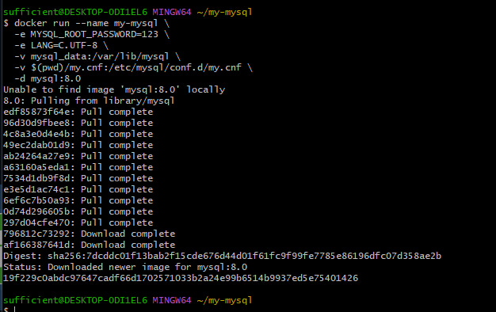
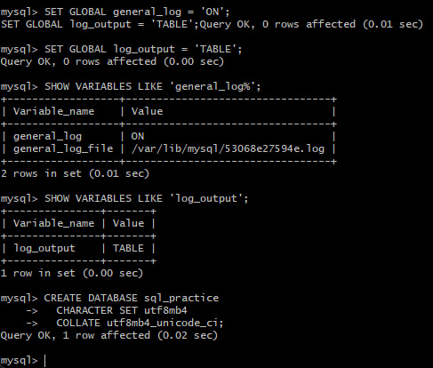
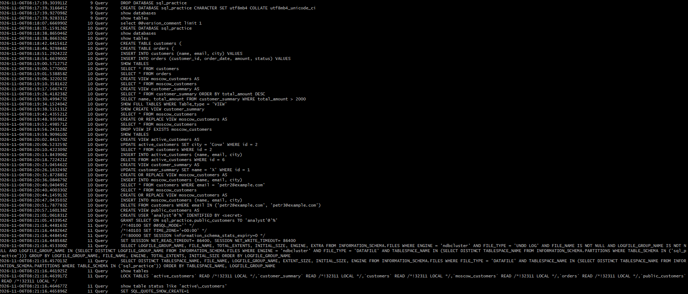

```markdown
# 🐬 Руководство по представлениям (VIEW) в MySQL на Windows

**Окружение:** Windows 10/11, Docker Desktop, Visual Studio Code, Git Bash.

> **Представление (VIEW)** — это сохранённый SQL-запрос, который выглядит как таблица. Вы обращаетесь к нему по имени, как к обычной таблице, но данных он не хранит — при каждом обращении запрос выполняется заново.

---

## 📋 Содержание
1. [Подготовка окружения](#1-подготовка-окружения)
2. [Настройка my.cnf](#2-настройка-mycnf)
3. [Создание контейнера](#3-создание-контейнера)
4. [Создание БД и таблиц](#4-создание-бд-и-таблиц)
5. [Работа с представлениями (VIEW)](#5-работа-с-представлениями-view)
6. [Права доступа через VIEW](#6-права-доступа-через-view)
7. [Создание дампа](#7-создание-дампа)
8. [Создание лога действий](#8-создание-лога-действий)
9. [Шпаргалка и типичные ошибки](#9-шпаргалка-и-типичные-ошибки)

---

## 1. Подготовка окружения

- [ ] Запустить **Docker Desktop** (дождаться статуса *Engine running*).
- [ ] Открыть **Git Bash**.
- [ ] Проверить работу Docker:
  ```bash
  docker ps
  ```
- [ ] Создать рабочую папку и открыть её в VS Code:
  ```bash
  mkdir -p ~/my-mysql
  cd ~/my-mysql
  code .
  ```

> ⚠️ **Важно:** Не используйте пути с пробелами и кириллицей. В VS Code убедитесь, что в правом нижнем углу статус-бара выбран перевод строк **LF** (а не CRLF).

---

## 2. Настройка my.cnf

- [ ] В VS Code создайте файл **`my.cnf`** (без расширения `.txt`) в папке `my-mysql`:

```ini
[mysqld]
character-set-server = utf8mb4
collation-server = utf8mb4_unicode_ci
general_log = 1
general_log_file = /var/lib/mysql/general.log
log_output = FILE

[client]
default-character-set = utf8mb4

[mysql]
default-character-set = utf8mb4
```

---

## 3. Создание контейнера

- [ ] Находясь в папке `my-mysql` в Git Bash, выполните:

```bash
docker run --name my-mysql \
  -e MYSQL_ROOT_PASSWORD=123 \
  -e LANG=C.UTF-8 \
  -e MYSQL_INITDB_SKIP_TZINFO=1 \
  -v mysql_data:/var/lib/mysql \
  -v "$(pwd)/my.cnf:/etc/mysql/conf.d/my.cnf" \
  -d mysql:8.0
```

- [ ] Проверить, что контейнер запущен (`STATUS: Up`):
```bash
docker ps -a
```

- [ ] Очистить лог перед началом работы:
```bash
docker exec my-mysql sh -c ': > /var/lib/mysql/general.log'
```

- [ ] Подключиться к MySQL (пароль: `123`):
```bash
docker exec -it my-mysql mysql --default-character-set=utf8mb4 -uroot -p
```

---

## 4. Создание БД и таблиц

*Все команды ниже выполняются внутри клиента MySQL (приглашение `mysql>`).*

- [ ] Создать БД и переключиться на неё:
```sql
CREATE DATABASE IF NOT EXISTS sql_practice
  CHARACTER SET utf8mb4
  COLLATE utf8mb4_unicode_ci;
USE sql_practice;
```

- [ ] Создать таблицы:
```sql
CREATE TABLE customers (
    id INT AUTO_INCREMENT PRIMARY KEY,
    name VARCHAR(100) NOT NULL,
    email VARCHAR(100) NOT NULL UNIQUE,
    city VARCHAR(100),
    created_at TIMESTAMP DEFAULT CURRENT_TIMESTAMP
) CHARACTER SET utf8mb4 COLLATE utf8mb4_unicode_ci;

CREATE TABLE orders (
    id INT AUTO_INCREMENT PRIMARY KEY,
    customer_id INT NOT NULL,
    order_date DATE NOT NULL,
    amount DECIMAL(10, 2) NOT NULL,
    status VARCHAR(20) DEFAULT 'new',
    FOREIGN KEY (customer_id) REFERENCES customers(id)
) CHARACTER SET utf8mb4 COLLATE utf8mb4_unicode_ci;
```

- [ ] Заполнить данными:
```sql
INSERT INTO customers (name, email, city) VALUES
  ('Иван Иванов', 'ivan@example.com', 'Москва'),
  ('Пётр Петров', 'petr@example.com', 'Санкт-Петербург'),
  ('Мария Сидорова', 'maria@example.com', 'Москва'),
  ('Алексей Смирнов', 'alex@example.com', 'Казань'),
  ('Ольга Кузнецова', 'olga@example.com', 'Новосибирск');

INSERT INTO orders (customer_id, order_date, amount, status) VALUES
  (1, '2026-10-01', 1500.00, 'paid'),
  (1, '2026-10-05', 2300.50, 'paid'),
  (2, '2026-10-03', 800.00, 'new'),
  (3, '2026-10-07', 4200.00, 'paid'),
  (3, '2026-10-10', 1100.00, 'cancelled'),
  (4, '2026-10-12', 950.00, 'new');
```

---

## 5. Работа с представлениями (VIEW)

- [ ] **Простое VIEW** (список клиентов из Москвы):
```sql
CREATE VIEW moscow_customers AS
SELECT id, name, email
FROM customers
WHERE city = 'Москва';

SELECT * FROM moscow_customers;
```

- [ ] **VIEW с JOIN и агрегацией** (сводка по клиентам):
```sql
CREATE VIEW customer_summary AS
SELECT c.id,
       c.name,
       c.city,
       COUNT(o.id)              AS order_count,
       COALESCE(SUM(o.amount), 0) AS total_amount
FROM customers c
LEFT JOIN orders o ON c.id = o.customer_id
GROUP BY c.id, c.name, c.city;

SELECT * FROM customer_summary ORDER BY total_amount DESC;
```

- [ ] **Просмотр и изменение VIEW**:
```sql
-- Посмотреть определение
SHOW CREATE VIEW customer_summary\G

-- Изменить VIEW
CREATE OR REPLACE VIEW moscow_customers AS
SELECT id, name, email, created_at
FROM customers
WHERE city = 'Москва';

-- Удалить VIEW
DROP VIEW IF EXISTS moscow_customers;
```

- [ ] **WITH CHECK OPTION** (защита от «невидимых» вставок):
```sql
CREATE OR REPLACE VIEW moscow_customers AS
SELECT id, name, email, city
FROM customers
WHERE city = 'Москва'
WITH CHECK OPTION;

-- Эта вставка выдаст ошибку (ERROR 1369)
INSERT INTO moscow_customers (name, email, city)
VALUES ('Пётр Второй', 'petr2@example.com', 'Казань');
```

---

## 6. Права доступа через VIEW

*Скрываем столбец `email` от пользователя `analyst`.*

- [ ] Выполнить в MySQL:
```sql
CREATE VIEW public_customers AS
SELECT id, name, city FROM customers;

CREATE USER 'analyst'@'%' IDENTIFIED BY 'pass';
GRANT SELECT ON sql_practice.public_customers TO 'analyst'@'%';
```

---

## 7. Создание дампа

- [ ] Выйти из MySQL в Git Bash:
```sql
\q
```

- [ ] Сделать дамп (файл `dump.sql` появится в папке проекта):
```bash
docker exec -e MYSQL_PWD=123 my-mysql mysqldump -uroot sql_practice > dump.sql
```

---

## 8. Создание лога действий

> ⚠️ **Важно для Windows:** в Git Bash есть баг с преобразованием Unix-путей. Чтобы команды `docker exec` не искали файлы на диске `C:`, используйте префикс `MSYS_NO_PATHCONV=1`.

- [ ] Забрать лог из контейнера в папку проекта:
```bash
MSYS_NO_PATHCONV=1 docker cp my-mysql:/var/lib/mysql/general.log ./general.log
```

- [ ] Отфильтровать служебные записи (получить только ваши SQL-запросы):
```bash
MSYS_NO_PATHCONV=1 docker exec my-mysql cat /var/lib/mysql/general.log \
  | grep "Query" \
  | grep -v -E "SET NAMES|SET autocommit|SET sql_mode|SET character_set_results|SHOW VARIABLES|SHOW STATUS|SHOW WARNINGS|SELECT @@|SELECT DATABASE\(\)|time_zone" \
  > my_actions.log
```

- [ ] Очистить лог для следующих задач:
```bash
docker exec my-mysql sh -c ': > /var/lib/mysql/general.log'
```

---

## 9. Шпаргалка и типичные ошибки

### 🛠 Шпаргалка по командам MySQL
| Действие | Команда |
|----------|---------|
| Создать VIEW | `CREATE VIEW name AS SELECT ...;` |
| Создать/Заменить VIEW | `CREATE OR REPLACE VIEW name AS SELECT ...;` |
| Удалить VIEW | `DROP VIEW IF EXISTS name;` |
| Показать все VIEW | `SHOW FULL TABLES WHERE Table_type = 'VIEW';` |
| Показать определение | `SHOW CREATE VIEW name\G` |

### 🐳 Шпаргалка по Docker (Git Bash)
| Действие | Команда |
|----------|---------|
| Зайти в MySQL | `docker exec -it my-mysql mysql --default-character-set=utf8mb4 -uroot -p` |
| Очистить лог | `docker exec my-mysql sh -c ': > /var/lib/mysql/general.log'` |
| Сделать дамп | `docker exec -e MYSQL_PWD=123 my-mysql mysqldump -uroot sql_practice > dump.sql` |
| Забрать файл из контейнера | `MSYS_NO_PATHCONV=1 docker cp my-mysql:/путь/в/контейнере ./локальный_путь` |

### ⚠️ Типичные ошибки в Windows
| Ошибка | Причина | Решение |
|--------|---------|---------|
| `ls: cannot access 'C:/Program Files/Git/...'` | Git Bash конвертирует Unix-путь в Windows-путь | Используйте префикс `MSYS_NO_PATHCONV=1` перед `docker exec` |
| `Cannot connect to the Docker daemon` | Docker Desktop не запущен | Запустите Docker Desktop и дождитесь Engine running |
| `mysqld: Error on realpath()` | В `my.cnf` переводы строк CRLF | Пересохраните файл в VS Code с LF (индикатор внизу справа) |
| `View 'x' already exists` | VIEW уже существует | Используйте `CREATE OR REPLACE` или удалите старое |
| `The target table ... is not updatable` | В VIEW есть `GROUP BY` или агрегаты | Не обновляйте данные через такое VIEW |
| `ERROR 2002 ... Can't connect ... socket` | Контейнер ещё загружается | Подождите 10–20 секунд и попробуйте снова |
| `ERROR 1007 ... database exists` | База уже создана | Используйте `CREATE DATABASE IF NOT EXISTS` |

---
*Файл сгенерирован для учебного курса по базам данных.*
```